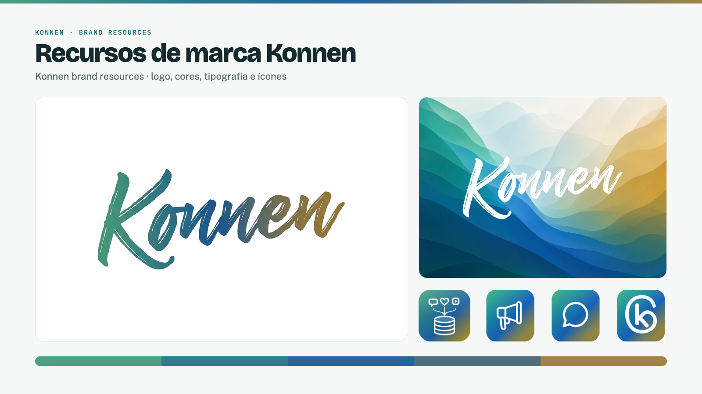
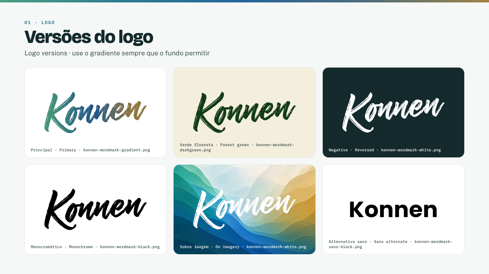
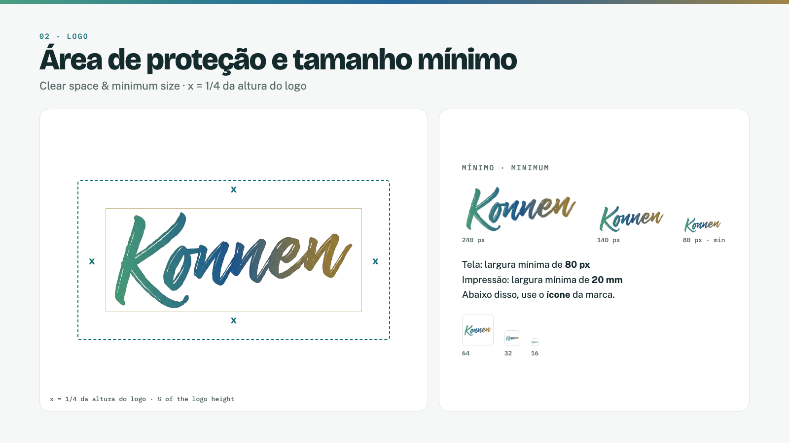
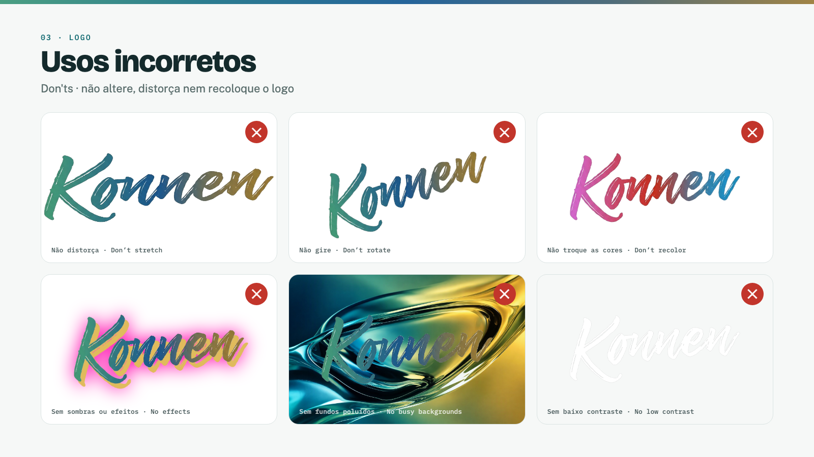
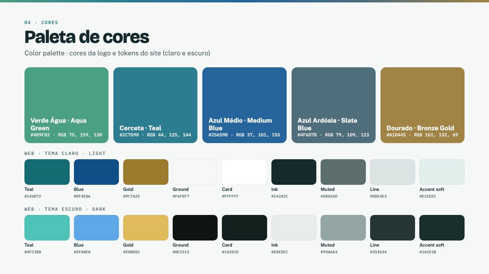
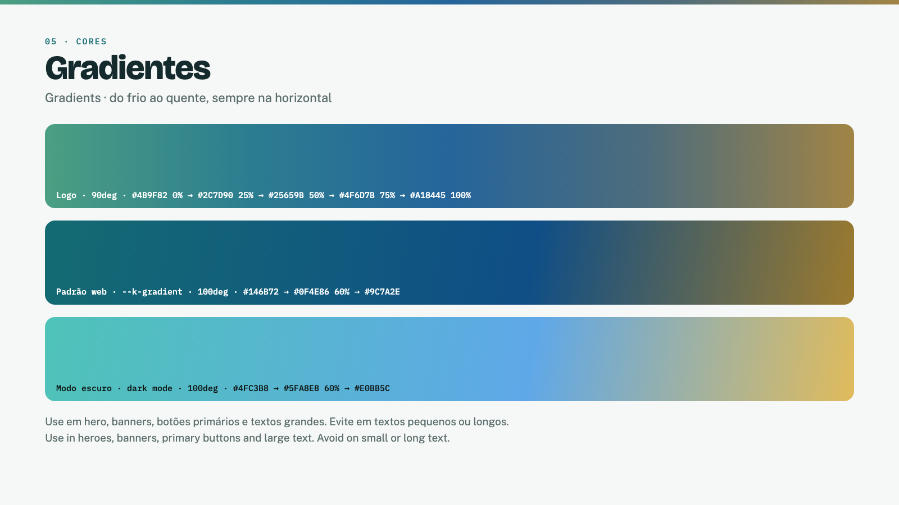
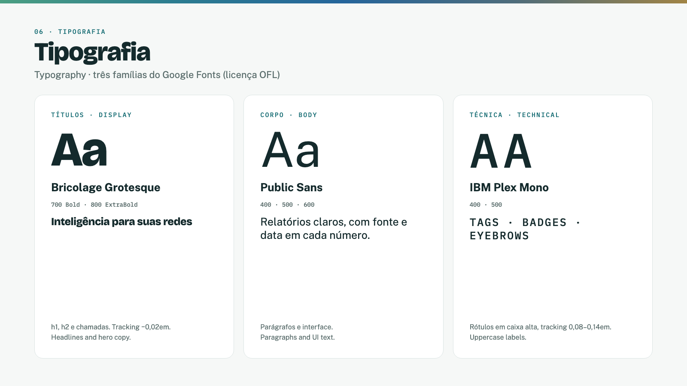
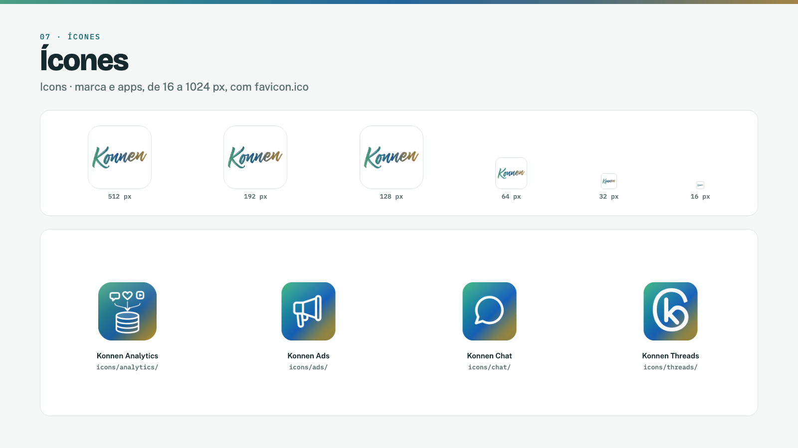
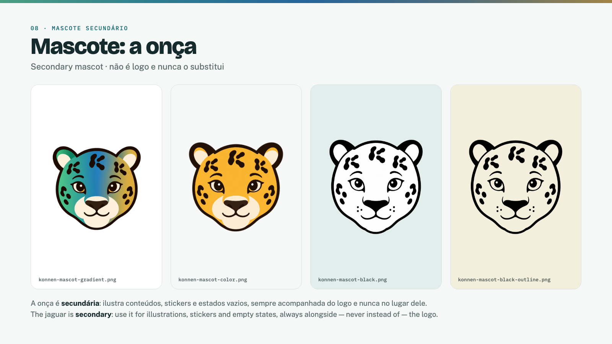
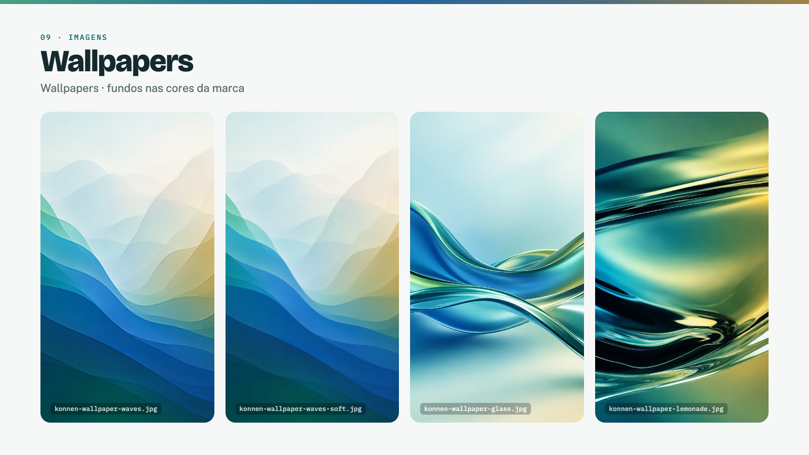

# Konnen · Brand resources

[Português](README.md) · **English**



Official **Konnen** logos, icons, colors, typography and imagery, with the basic usage rules. Use these files to talk
about Konnen or our products without recreating anything.

- 📄 **Full guide (PDF):** [docs/konnen-brand-guidelines.pdf](docs/konnen-brand-guidelines.pdf)
- 🎨 **Web page guide (CSS and tokens, in Portuguese):** [docs/web-design-guide.md](docs/web-design-guide.md)
- ⚖️ **Brand terms of use:** [LICENSE.md](LICENSE.md)

## Contents

1. [Logo](#1-logo)
2. [Clear space and minimum size](#2-clear-space-and-minimum-size)
3. [Misuse](#3-misuse)
4. [Colors](#4-colors)
5. [Gradients](#5-gradients)
6. [Typography](#6-typography)
7. [Icons](#7-icons)
8. [Secondary mascot: the jaguar](#8-secondary-mascot-the-jaguar)
9. [Wallpapers](#9-wallpapers)
10. [Repository structure](#repository-structure)

---

## 1. Logo

The Konnen logo is the **hand-lettered "Konnen" wordmark**. The primary version is the **gradient** one; use the others
only when the background calls for it.



| Version | When to use | File |
| --- | --- | --- |
| **Gradient (primary)** | White or light backgrounds. First choice. | [konnen-wordmark-gradient.png](logo/wordmark/konnen-wordmark-gradient.png) |
| Forest green | Light backgrounds when the gradient isn't possible (single color). | [konnen-wordmark-darkgreen.png](logo/wordmark/konnen-wordmark-darkgreen.png) |
| White (reversed) | Dark backgrounds, photos and wallpapers. | [konnen-wordmark-white.png](logo/wordmark/konnen-wordmark-white.png) |
| White with "agência" | Konnen communication as an agency. | [konnen-wordmark-white-agencia.png](logo/wordmark/konnen-wordmark-white-agencia.png) |
| Black (monochrome) | One-color print, stamps, black-and-white documents. | [konnen-wordmark-black.png](logo/wordmark/konnen-wordmark-black.png) |
| Sans (alternate) | Technical contexts, or sizes where the script loses legibility. | [black](logo/wordmark-sans/konnen-wordmark-sans-black.png) · [white](logo/wordmark-sans/konnen-wordmark-sans-white.png) |

**Other logo artwork:**

| Artwork | Files |
| --- | --- |
| Square tile (wordmark inside a rounded square) | [transparent](logo/tile/konnen-tile-transparent.png) · [dark](logo/tile/konnen-tile-dark.png) · [light](logo/tile/konnen-tile-light.png) |
| "K" monogram | [forest-green K](logo/monogram/konnen-monogram-k-darkgreen.png) · [circle K, black](logo/monogram/konnen-monogram-circle-black.png) · [circle K, white](logo/monogram/konnen-monogram-circle-white.png) |

> Every PNG has a transparent background and an even margin. The file
> [konnen-wordmark-gradient.svg](logo/wordmark/konnen-wordmark-gradient.svg) wraps the PNG (it is not a vector); a
> vector version is not available yet.

## 2. Clear space and minimum size



- **Clear space:** keep an area of **x = ¼ of the logo height** free around the logo. No text, borders or other
  elements inside it.
- **Minimum size:** **80 px** wide on screen and **20 mm** in print.
- Below that, use the [brand icon](#7-icons).

## 3. Misuse



Don't:

1. stretch or change the proportions;
2. rotate or skew it;
3. change the colors or apply another gradient;
4. add shadows, glows, outlines or other effects;
5. place it on busy backgrounds that hurt legibility;
6. use it with low contrast (for example, the white logo on a light background).

Also, don't recreate the logo with another typeface, don't split or rearrange the letters, and don't combine it with
other logos without permission.

## 4. Colors



### Logo colors

They make up the logo gradient, from cool (green) to warm (gold).

| Name | HEX | RGB | Suggested use |
| --- | --- | --- | --- |
| Aqua Green | `#4B9F82` | 75, 159, 130 | Success, icons, soft highlights |
| Teal | `#2C7D90` | 44, 125, 144 | Secondary elements, borders |
| Medium Blue | `#25659B` | 37, 101, 155 | Primary color: buttons, links, headers |
| Slate Blue | `#4F6D7B` | 79, 109, 123 | Secondary backgrounds, subtitles |
| Bronze Gold | `#A18445` | 161, 132, 69 | Calls to action (CTA), premium highlights |

Supporting color: **Forest green** `#103A16`, used in the single-color wordmark.

### Web colors (CSS tokens)

| Token | Light theme | Dark theme | Role |
| --- | --- | --- | --- |
| `--k-teal` | `#146B72` | `#4FC3B8` | Accent color (`--accent`) |
| `--k-blue` | `#0F4E86` | `#5FA8E8` | Brand blue |
| `--k-gold` | `#9C7A2E` | `#E0BB5C` | Brand gold |
| `--ground` | `#F6F8F7` | `#0E1513` | Page background |
| `--card` | `#FFFFFF` | `#14201E` | Cards and containers |
| `--ink` | `#142A2C` | `#E8EDEC` | Primary text |
| `--muted` | `#5B6E6D` | `#93A6A3` | Secondary text |
| `--line` | `#DBE4E3` | `#253634` | Borders and dividers |
| `--accent-soft` | `#E1EEEC` | `#1A2E2B` | Soft backgrounds and hover |

The ready-to-use CSS, with the `:root` variables and dark mode, is in [docs/web-design-guide.md](docs/web-design-guide.md).

**Contrast:** don't use thin white text on Aqua Green `#4B9F82`. For text, prefer `--ink` and `--muted`.

## 5. Gradients



```css
/* Logo gradient */
background: linear-gradient(90deg, #4B9F82 0%, #2C7D90 25%, #25659B 50%, #4F6D7B 75%, #A18445 100%);

/* Default site gradient (--k-gradient) */
background: linear-gradient(100deg, #146B72, #0F4E86 60%, #9C7A2E);

/* Dark mode */
background: linear-gradient(100deg, #4FC3B8, #5FA8E8 60%, #E0BB5C);
```

Use them in heroes, banners, primary buttons and large text. Avoid them on small or long text and on very narrow buttons.

## 6. Typography



All three typefaces are free on Google Fonts ([SIL Open Font License](https://openfontlicense.org)).

| Role | Typeface | Weights | Use |
| --- | --- | --- | --- |
| Headlines | [Bricolage Grotesque](https://fonts.google.com/specimen/Bricolage+Grotesque) | 700, 800 | `h1`, `h2`, hero copy. Tracking `-0.02em`. |
| Body | [Public Sans](https://fonts.google.com/specimen/Public+Sans) | 400, 500, 600 | Paragraphs, descriptions and UI. |
| Technical | [IBM Plex Mono](https://fonts.google.com/specimen/IBM+Plex+Mono) | 400, 500 | Tags, badges, eyebrows and footer, uppercase with `0.08–0.14em` tracking. |

```html
<link rel="preconnect" href="https://fonts.googleapis.com">
<link rel="preconnect" href="https://fonts.gstatic.com" crossorigin>
<link href="https://fonts.googleapis.com/css2?family=Bricolage+Grotesque:opsz,wght@12..96,700;12..96,800&family=Public+Sans:wght@400;500;600&family=IBM+Plex+Mono:wght@400;500&display=swap" rel="stylesheet">
```

The wordmark is custom hand lettering: don't try to reproduce it with a font; always use the files in [logo/](logo/).

## 7. Icons



Each folder has the icon at **1024, 512, 192, 180, 128, 64, 48, 32 and 16 px**, plus `favicon.ico` (16/32/48) and
`apple-touch-icon.png` (180 px, opaque background).

| Icon | Folder |
| --- | --- |
| **Konnen (brand)**: gradient wordmark. Includes `konnen-icon-maskable-512.png` and `site.webmanifest`. | [icons/konnen/](icons/konnen/) |
| Konnen Analytics | [icons/analytics/](icons/analytics/) |
| Konnen Ads | [icons/ads/](icons/ads/) |
| Konnen Chat | [icons/chat/](icons/chat/) |
| Konnen Threads | [icons/threads/](icons/threads/) |
| Blank base (for new apps) | [icons/app-base/](icons/app-base/) |

Example for a website:

```html
<link rel="icon" href="/favicon.ico" sizes="any">
<link rel="icon" type="image/png" sizes="32x32" href="/konnen-icon-32.png">
<link rel="apple-touch-icon" href="/apple-touch-icon.png">
<link rel="manifest" href="/site.webmanifest">
```

> At 16 px the wordmark is hard to read; for tabs and very small lists, prefer the 32 px size.

## 8. Secondary mascot: the jaguar



The jaguar is Konnen’s **mascot** and plays a **secondary** role: it is not part of the logo and lives in [mascot/](mascot/), separate from it. It use it for illustrations, stickers, empty states and casual content, always
**alongside** the logo and **never instead of it**.

| Version | File |
| --- | --- |
| Gradient | [konnen-mascot-gradient.png](mascot/konnen-mascot-gradient.png) |
| Color | [konnen-mascot-color.png](mascot/konnen-mascot-color.png) |
| Black, white fill | [konnen-mascot-black.png](mascot/konnen-mascot-black.png) |
| Black, outline only | [konnen-mascot-black-outline.png](mascot/konnen-mascot-black-outline.png) |
| Black on white | [konnen-mascot-black-on-white.png](mascot/konnen-mascot-black-on-white.png) |

## 9. Wallpapers



| File | Size |
| --- | --- |
| [konnen-wallpaper-waves.jpg](wallpapers/konnen-wallpaper-waves.jpg) | 3072 × 3072 |
| [konnen-wallpaper-waves-soft.jpg](wallpapers/konnen-wallpaper-waves-soft.jpg) | 1024 × 1024 |
| [konnen-wallpaper-glass.jpg](wallpapers/konnen-wallpaper-glass.jpg) | 1536 × 1024 |
| [konnen-wallpaper-lemonade.jpg](wallpapers/konnen-wallpaper-lemonade.jpg) | 1536 × 1024 |

---

## Repository structure

```text
logo/
  wordmark/        primary logo (gradient, forest green, white, black)
  wordmark-sans/   sans alternate (black and white)
  tile/            wordmark in a rounded square
  monogram/        "K" monograms
mascot/            jaguar, secondary mascot (not a logo)
icons/             brand and app icons in several sizes + favicon.ico
wallpapers/        backgrounds in the brand colors
docs/              PDF guide, guide images and web guide (CSS)
tools/             scripts that build the derived files
```

**Naming convention:** `konnen-<type>-<variant>[-<size>].<ext>`, in English, lowercase and hyphenated. Examples:
`konnen-wordmark-gradient.png`, `konnen-chat-512.png`.

### Rebuilding icons and the guide

The icons, the black and white-sans logo variants, the images in `docs/img/` and the PDF are generated from the
original artwork:

```bash
uv run --with pillow python tools/build_brand.py           # everything (requires Google Chrome)
uv run --with pillow python tools/build_brand.py --icons   # logos and icons only
```

To replace an artwork, swap the master file (`logo/wordmark/konnen-wordmark-gradient.png` or
`icons/<app>/konnen-<app>-1024.png`) and run the script.

## Terms of use

© Konnen. All rights reserved. These files are public **to make correct references to Konnen easy** (press, partners,
integrations and materials about our products). They are **not** under an open-source license: don't modify the
brand or use it in a way that suggests sponsorship, partnership or endorsement without permission. See
[LICENSE.md](LICENSE.md).

Questions or usage requests: open an [issue](https://github.com/thekonnen/konnen_assets/issues).
