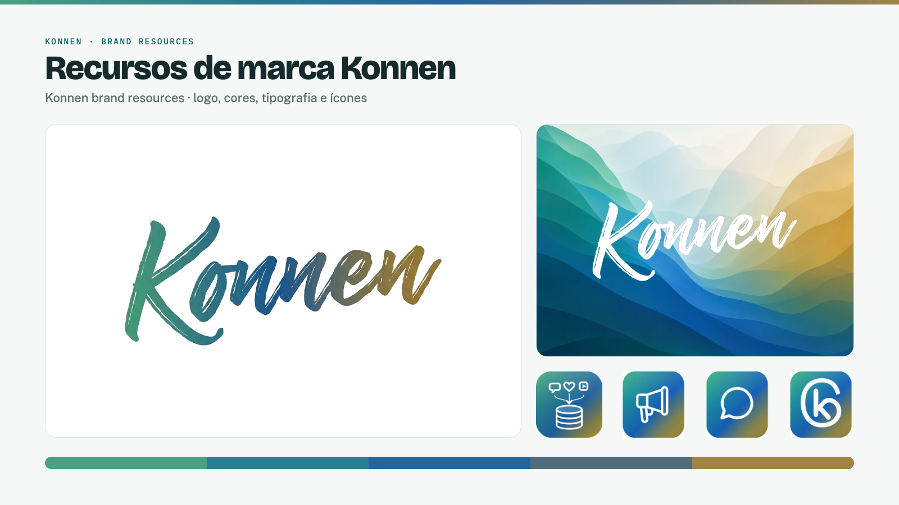
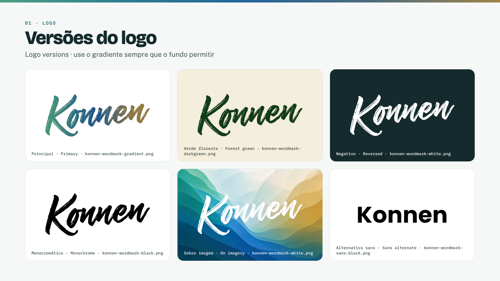
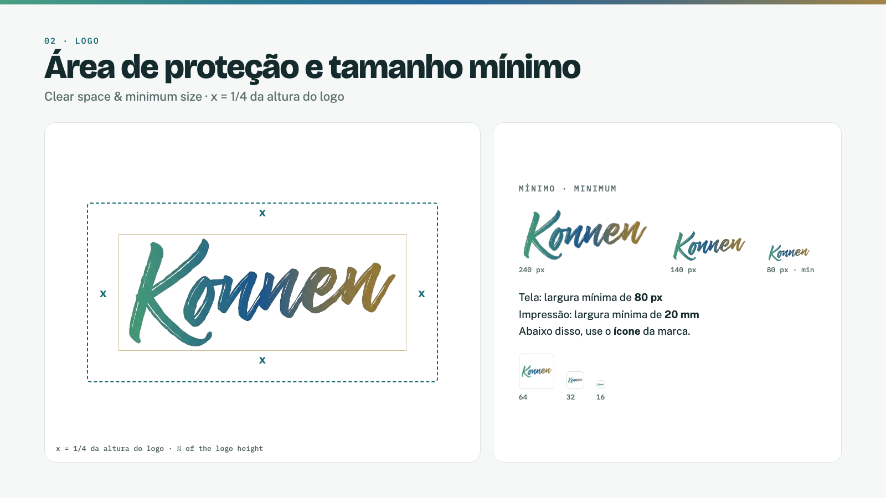
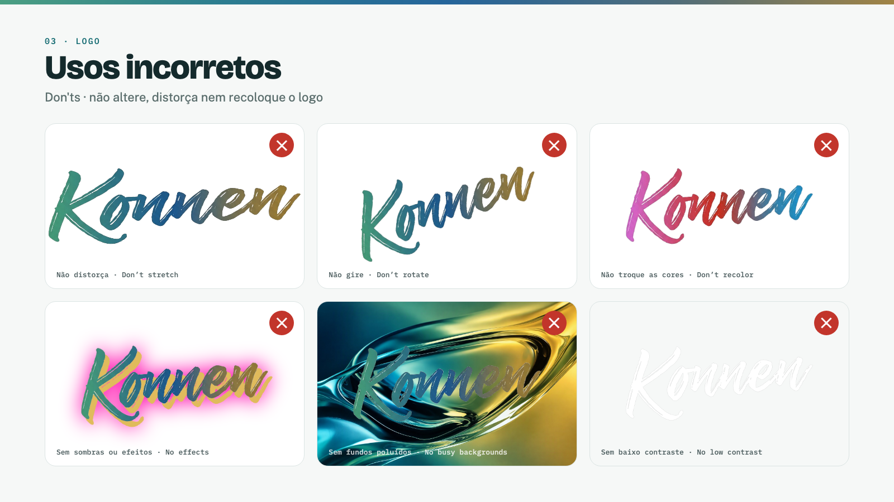
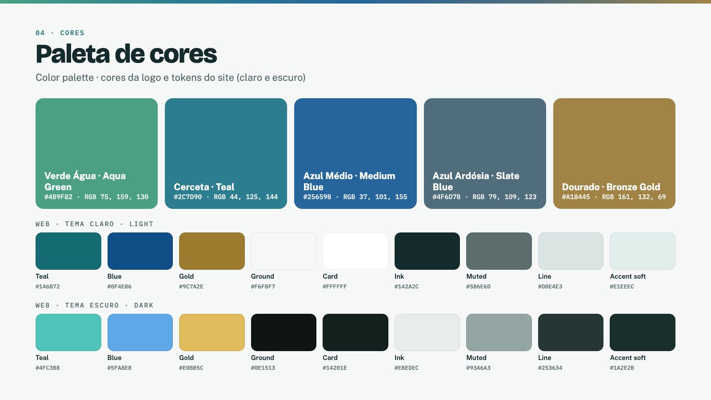
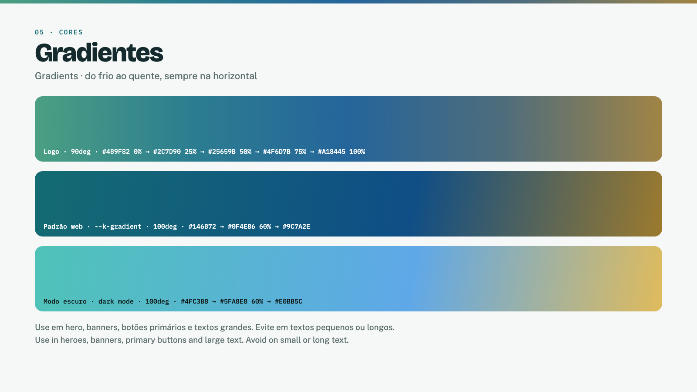
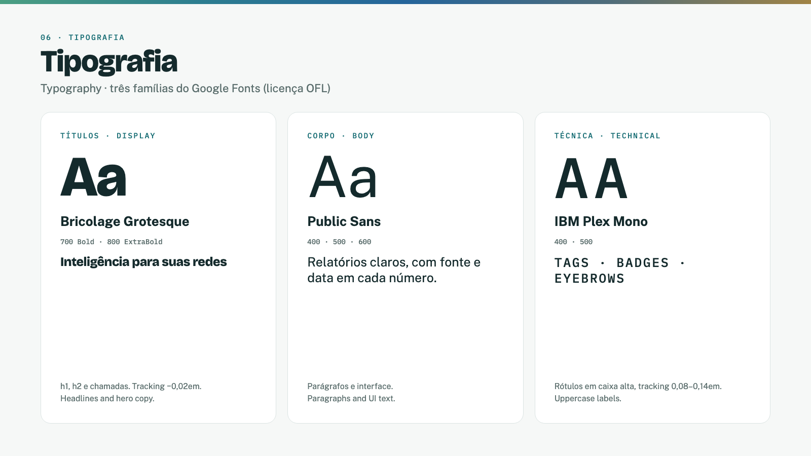
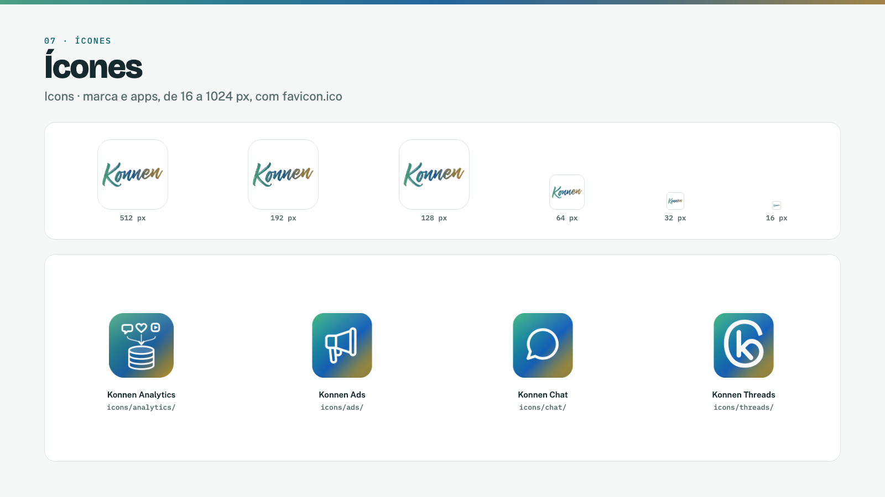
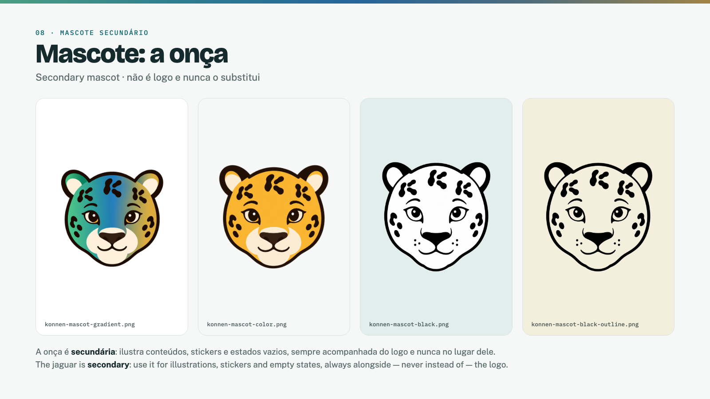
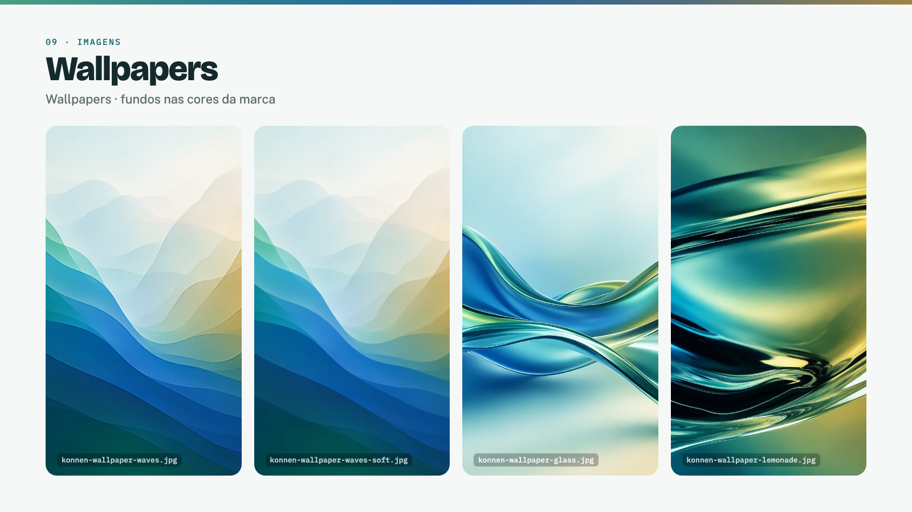

# Konnen · Recursos de marca

**Português** · [English](README.en.md)



Logos, ícones, cores, tipografia e imagens oficiais da **Konnen**, com as regras básicas de uso. Use estes arquivos
para falar da Konnen ou dos nossos produtos sem precisar recriar nada.

- 📄 **Guia completo em PDF:** [docs/konnen-brand-guidelines.pdf](docs/konnen-brand-guidelines.pdf)
- 🎨 **Guia para páginas web (CSS e tokens):** [docs/web-design-guide.md](docs/web-design-guide.md)
- ⚖️ **Termos de uso da marca:** [LICENSE.md](LICENSE.md)

## Sumário

1. [Logo](#1-logo)
2. [Área de proteção e tamanho mínimo](#2-área-de-proteção-e-tamanho-mínimo)
3. [Usos incorretos](#3-usos-incorretos)
4. [Cores](#4-cores)
5. [Gradientes](#5-gradientes)
6. [Tipografia](#6-tipografia)
7. [Ícones](#7-ícones)
8. [Mascote secundário: a onça](#8-mascote-secundário-a-onça)
9. [Wallpapers](#9-wallpapers)
10. [Estrutura do repositório](#estrutura-do-repositório)

---

## 1. Logo

O logo da Konnen é o **wordmark manuscrito "Konnen"**. A versão principal é a **em gradiente**; use as demais só quando
o fundo pedir.



| Versão | Quando usar | Arquivo |
| --- | --- | --- |
| **Gradiente (principal)** | Fundos brancos ou claros. Primeira escolha. | [konnen-wordmark-gradient.png](logo/wordmark/konnen-wordmark-gradient.png) |
| Verde floresta | Fundos claros quando o gradiente não for possível (uma cor só). | [konnen-wordmark-darkgreen.png](logo/wordmark/konnen-wordmark-darkgreen.png) |
| Branco (negativo) | Fundos escuros, fotos e wallpapers. | [konnen-wordmark-white.png](logo/wordmark/konnen-wordmark-white.png) |
| Branco com "agência" | Comunicação da Konnen como agência. | [konnen-wordmark-white-agencia.png](logo/wordmark/konnen-wordmark-white-agencia.png) |
| Preto (monocromático) | Impressão em uma cor, carimbos, documentos P&B. | [konnen-wordmark-black.png](logo/wordmark/konnen-wordmark-black.png) |
| Sans (alternativa) | Contextos técnicos ou tamanhos em que o manuscrito perde legibilidade. | [preto](logo/wordmark-sans/konnen-wordmark-sans-black.png) · [branco](logo/wordmark-sans/konnen-wordmark-sans-white.png) |

**Outras artes do logo:**

| Arte | Arquivos |
| --- | --- |
| Tile quadrado (wordmark dentro de um quadrado arredondado) | [transparente](logo/tile/konnen-tile-transparent.png) · [escuro](logo/tile/konnen-tile-dark.png) · [claro](logo/tile/konnen-tile-light.png) |
| Monograma "K" | [K verde floresta](logo/monogram/konnen-monogram-k-darkgreen.png) · [K em círculo, preto](logo/monogram/konnen-monogram-circle-black.png) · [K em círculo, branco](logo/monogram/konnen-monogram-circle-white.png) |

> Todos os PNGs têm fundo transparente e margem uniforme. O arquivo
> [konnen-wordmark-gradient.svg](logo/wordmark/konnen-wordmark-gradient.svg) contém o PNG embutido (não é vetor);
> uma versão vetorial ainda não está disponível.

## 2. Área de proteção e tamanho mínimo



- **Área de proteção:** mantenha livre, em volta do logo, um espaço **x = 1/4 da altura do logo**. Nada de textos,
  bordas ou outros elementos dentro dessa área.
- **Tamanho mínimo:** **80 px** de largura em tela e **20 mm** em impressão.
- Abaixo disso, use o [ícone da marca](#7-ícones).

## 3. Usos incorretos



Não:

1. distorça nem mude as proporções;
2. gire ou incline;
3. troque as cores ou aplique outro gradiente;
4. adicione sombras, brilhos, contornos ou outros efeitos;
5. aplique sobre fundos poluídos que prejudiquem a leitura;
6. use com baixo contraste (por exemplo, logo branco em fundo claro).

Também não recrie o logo com outra fonte, não separe ou reorganize as letras e não o combine com outros logos sem
autorização.

## 4. Cores



### Cores da logo

Compõem o gradiente do logo, do frio (verde) ao quente (dourado).

| Nome | HEX | RGB | Uso sugerido |
| --- | --- | --- | --- |
| Verde Água | `#4B9F82` | 75, 159, 130 | Sucesso, ícones, destaques suaves |
| Cerceta (Teal) | `#2C7D90` | 44, 125, 144 | Elementos secundários, bordas |
| Azul Médio | `#25659B` | 37, 101, 155 | Cor primária: botões, links, cabeçalhos |
| Azul Ardósia | `#4F6D7B` | 79, 109, 123 | Fundos secundários, subtítulos |
| Dourado / Bronze | `#A18445` | 161, 132, 69 | Chamadas para ação (CTA), destaques premium |

Cor de apoio: **Verde floresta** `#103A16`, usada no wordmark de uma cor.

### Cores para web (tokens CSS)

| Token | Tema claro | Tema escuro | Papel |
| --- | --- | --- | --- |
| `--k-teal` | `#146B72` | `#4FC3B8` | Cor de destaque (`--accent`) |
| `--k-blue` | `#0F4E86` | `#5FA8E8` | Azul da marca |
| `--k-gold` | `#9C7A2E` | `#E0BB5C` | Dourado da marca |
| `--ground` | `#F6F8F7` | `#0E1513` | Fundo da página |
| `--card` | `#FFFFFF` | `#14201E` | Cards e containers |
| `--ink` | `#142A2C` | `#E8EDEC` | Texto principal |
| `--muted` | `#5B6E6D` | `#93A6A3` | Texto secundário |
| `--line` | `#DBE4E3` | `#253634` | Bordas e divisores |
| `--accent-soft` | `#E1EEEC` | `#1A2E2B` | Fundos suaves e hover |

O CSS pronto, com as variáveis em `:root` e o modo escuro, está em [docs/web-design-guide.md](docs/web-design-guide.md).

**Contraste:** não use texto branco fino sobre o Verde Água `#4B9F82`. Para textos, prefira `--ink` e `--muted`.

## 5. Gradientes



```css
/* Gradiente da logo */
background: linear-gradient(90deg, #4B9F82 0%, #2C7D90 25%, #25659B 50%, #4F6D7B 75%, #A18445 100%);

/* Gradiente padrão do site (--k-gradient) */
background: linear-gradient(100deg, #146B72, #0F4E86 60%, #9C7A2E);

/* Modo escuro */
background: linear-gradient(100deg, #4FC3B8, #5FA8E8 60%, #E0BB5C);
```

Use em hero, banners, botões primários e textos grandes. Evite em textos pequenos ou longos e em botões muito estreitos.

## 6. Tipografia



As três fontes são gratuitas no Google Fonts (licença [SIL Open Font License](https://openfontlicense.org)).

| Papel | Fonte | Pesos | Uso |
| --- | --- | --- | --- |
| Títulos | [Bricolage Grotesque](https://fonts.google.com/specimen/Bricolage+Grotesque) | 700, 800 | `h1`, `h2`, chamadas de impacto. Tracking `-0.02em`. |
| Corpo | [Public Sans](https://fonts.google.com/specimen/Public+Sans) | 400, 500, 600 | Parágrafos, descrições e interface. |
| Técnica | [IBM Plex Mono](https://fonts.google.com/specimen/IBM+Plex+Mono) | 400, 500 | Tags, badges, eyebrows e rodapé, em caixa alta com tracking `0.08–0.14em`. |

```html
<link rel="preconnect" href="https://fonts.googleapis.com">
<link rel="preconnect" href="https://fonts.gstatic.com" crossorigin>
<link href="https://fonts.googleapis.com/css2?family=Bricolage+Grotesque:opsz,wght@12..96,700;12..96,800&family=Public+Sans:wght@400;500;600&family=IBM+Plex+Mono:wght@400;500&display=swap" rel="stylesheet">
```

O wordmark é um lettering manuscrito: não tente reproduzi-lo com uma fonte; use sempre os arquivos de [logo/](logo/).

## 7. Ícones



Cada pasta traz o ícone em **1024, 512, 192, 180, 128, 64, 48, 32 e 16 px**, mais `favicon.ico` (16/32/48) e
`apple-touch-icon.png` (180 px, fundo opaco).

| Ícone | Pasta |
| --- | --- |
| **Konnen (marca)**: wordmark em gradiente. Inclui `konnen-icon-maskable-512.png` e `site.webmanifest`. | [icons/konnen/](icons/konnen/) |
| Konnen Analytics | [icons/analytics/](icons/analytics/) |
| Konnen Ads | [icons/ads/](icons/ads/) |
| Konnen Chat | [icons/chat/](icons/chat/) |
| Konnen Threads | [icons/threads/](icons/threads/) |
| Base sem símbolo (para novos apps) | [icons/app-base/](icons/app-base/) |

Exemplo de uso em um site:

```html
<link rel="icon" href="/favicon.ico" sizes="any">
<link rel="icon" type="image/png" sizes="32x32" href="/konnen-icon-32.png">
<link rel="apple-touch-icon" href="/apple-touch-icon.png">
<link rel="manifest" href="/site.webmanifest">
```

> Em 16 px o wordmark fica pouco legível; para abas e listas muito pequenas, prefira o tamanho de 32 px.

## 8. Mascote secundário: a onça



A onça é o **mascote** da Konnen e tem papel **secundário**: não faz parte do logo e fica em [mascot/](mascot/), separada dele. Ela serve para ilustrações, stickers, estados vazios e conteúdos descontraídos,
sempre **acompanhando** o logo e **nunca no lugar dele**.

| Versão | Arquivo |
| --- | --- |
| Gradiente | [konnen-mascot-gradient.png](mascot/konnen-mascot-gradient.png) |
| Colorida | [konnen-mascot-color.png](mascot/konnen-mascot-color.png) |
| Preta, com preenchimento branco | [konnen-mascot-black.png](mascot/konnen-mascot-black.png) |
| Preta, só contorno | [konnen-mascot-black-outline.png](mascot/konnen-mascot-black-outline.png) |
| Preta sobre branco | [konnen-mascot-black-on-white.png](mascot/konnen-mascot-black-on-white.png) |

## 9. Wallpapers



| Arquivo | Tamanho |
| --- | --- |
| [konnen-wallpaper-waves.jpg](wallpapers/konnen-wallpaper-waves.jpg) | 3072 × 3072 |
| [konnen-wallpaper-waves-soft.jpg](wallpapers/konnen-wallpaper-waves-soft.jpg) | 1024 × 1024 |
| [konnen-wallpaper-glass.jpg](wallpapers/konnen-wallpaper-glass.jpg) | 1536 × 1024 |
| [konnen-wallpaper-lemonade.jpg](wallpapers/konnen-wallpaper-lemonade.jpg) | 1536 × 1024 |

---

## Estrutura do repositório

```text
logo/
  wordmark/        logo principal (gradiente, verde floresta, branco, preto)
  wordmark-sans/   alternativa sans (preto e branco)
  tile/            wordmark em quadrado arredondado
  monogram/        monogramas "K"
mascot/            onça, mascote secundário (não é logo)
icons/             ícones da marca e dos apps em vários tamanhos + favicon.ico
wallpapers/        fundos nas cores da marca
docs/              guia em PDF, imagens do guia e guia web (CSS)
tools/             scripts que geram os derivados
```

**Padrão de nomes:** `konnen-<tipo>-<variante>[-<tamanho>].<ext>`, em inglês, minúsculas e com hífens. Exemplos:
`konnen-wordmark-gradient.png`, `konnen-chat-512.png`.

### Regenerar ícones e o guia

Os ícones, as variantes preta e sans branca do logo, as imagens de `docs/img/` e o PDF são gerados a partir das artes
originais:

```bash
uv run --with pillow python tools/build_brand.py           # tudo (requer Google Chrome)
uv run --with pillow python tools/build_brand.py --icons   # só logos e ícones
```

Ao trocar uma arte, substitua o arquivo-mestre (`logo/wordmark/konnen-wordmark-gradient.png` ou
`icons/<app>/konnen-<app>-1024.png`) e rode o script.

## Termos de uso

© Konnen. Todos os direitos reservados. Os arquivos estão públicos **para facilitar referências corretas à Konnen**
(imprensa, parceiros, integrações e materiais sobre nossos produtos). Eles **não** estão sob licença de código aberto:
não altere a marca nem a use de forma que sugira patrocínio, parceria ou endosso sem autorização. Detalhes em
[LICENSE.md](LICENSE.md).

Dúvidas ou pedidos de uso: abra uma [issue](https://github.com/thekonnen/konnen_assets/issues).
